# Hub de Aprendizaje de Inglés (Wordie)

## Descripción general
Wordie es una aplicación web interactiva para aprender inglés, construida con tecnologías frontend modernas. Ofrece gramática, vocabulario, historias, frases, fonética y juegos para que los usuarios practiquen inglés de forma lúdica.

## Tecnologías
- **Framework:** React 19 (componentes declarados con `function`)
- **Lenguaje:** TypeScript (modo estricto)
- **Compilación:** Vite 8
- **Estilos:** Tailwind CSS v4
- **Gestión de estado:** Zustand
- **Animaciones:** motion/react (sin framer‑motion)
- **Ruteo:** React Router DOM v7
- **Pruebas:** Vitest + Playwright (navegador)
- **Storybook:** 10.6.1 para documentación de componentes UI
- **Gestor de paquetes:** pnpm 9
- **Herramientas backend:** Servidor MCP (english‑hub‑mcp) para mapa de arquitectura, auditorías y registro de decisiones.

## Arquitectura
El código está claramente separado entre componentes reutilizables (`@common`) y módulos de funcionalidad (`src/features/*`). Cada módulo sigue una estructura de carpetas canónica:
```
src/features/<Feature>/
├── components/
│   └── <Component>/
│       ├── index.tsx      // implementación del componente (declaración de función)
│       ├── type.ts        // tipos de props
│       ├── constant.ts    // constantes de animación o UI
│       └── <Component>.stories.tsx // historia de Storybook
├── dto/                // contratos JSON (interfaces)
├── hooks/              // obtención de datos a nivel de feature
├── store/              // store Zustand (si es necesario)
└── index.tsx           // componente raíz del feature
```
La configuración de rutas carga de forma diferida cada feature usando `LoadSuspense`, generando chunks independientes y manteniendo ligero el bundle inicial.

### Diagrama de arquitectura
El siguiente diagrama fue generado automáticamente por el servidor MCP mediante la herramienta `generar_diagrama_arquitectura` con vista `global` y profundidad `detallado`:

```mermaid
flowchart TD
  subgraph Rutas
    R_Home["/ Home"]
    R_Grammar["/grammar"]
    R_Phrases["/phrases"]
    R_Stories["/stories"]
    R_Vocabulary["/vocabulary"]
  end

  subgraph Features
    F_Games[GamesModule - 9 componentes]
    F_Grammar[GrammarModule - 14 componentes]
    F_Home[HomeModule - 14 componentes]
    F_Phonetics[PhoneticsModule - 8 componentes]
    F_PhrasalVerbs[PhrasalVerbsModule - 7 componentes]
    F_Phrases[PhrasesModule - 5 componentes]
    F_Stories[StoriesModule - 9 componentes]
    F_Vocabulary[VocabularyModule - 11 componentes]
  end

  subgraph Stores
    S_useVocabStore[useVocabStore - persiste en LS]
    S_useTopicStore[useTopicStore]
    S_useTourStore[useTourStore]
  end

  subgraph Datos
    D_grammar[grammar.json - 18 items]
    D_phonetics[phonetics.json - 44 items]
    D_phrasal[phrasal-verbs.json - 22 items]
    D_phrases[phrases.json - 40 items]
    D_stories[stories.json - 6 items]
    D_vocabulary[vocabulary.json - 40 items]
    D_LS[localStorage]
  end

  subgraph Common
    C_BottomNav[BottomNav]
    C_Button[Button]
    C_CardBase[CardBase]
    C_Chip[Chip]
    C_Dropdown[Dropdown]
    C_ErrorBoundary[ErrorBoundary]
    C_ErrorBoundaryFallback[ErrorBoundaryFallback]
    C_ErrorLottieAnimation[ErrorLottieAnimation]
    C_ErrorState[ErrorState]
    C_ErrorTechnicalDetails[ErrorTechnicalDetails]
    C_FloatingHelpButton[FloatingHelpButton]
    C_HelpModalDialog[HelpModalDialog]
    C_NavExtraMenu[NavExtraMenu]
    C_Navbar[Navbar]
    C_OnboardingTour[OnboardingTour]
    C_RouteErrorFallback[RouteErrorFallback]
    C_SkeletonPage[SkeletonPage]
  end

  R_Home --> F_Home
  R_Grammar --> F_Grammar
  R_Phrases --> F_Phrases
  R_Stories --> F_Stories
  R_Vocabulary --> F_Vocabulary

  F_Vocabulary --> S_useVocabStore
  S_useVocabStore --> D_LS
  D_LS --> S_useVocabStore

  F_Grammar -.-> D_grammar
  F_Phonetics -.-> D_phonetics
  F_Phrases -.-> D_phrases
  F_Stories -.-> D_stories
  F_Vocabulary -.-> D_vocabulary

  F_Games -.-> C_FloatingHelpButton
  F_Games -.-> C_HelpModalDialog
  F_Games -.-> C_Button
  F_Grammar -.-> C_Button
  F_Grammar -.-> C_SkeletonPage
  F_Grammar -.-> C_ErrorState
  F_Grammar -.-> C_CardBase
  F_Grammar -.-> C_Chip
  F_Home -.-> C_Button
  F_Home -.-> C_CardBase
  F_Phonetics -.-> C_ErrorState
  F_Phonetics -.-> C_FloatingHelpButton
  F_Phonetics -.-> C_SkeletonPage
  F_PhrasalVerbs -.-> C_CardBase
  F_PhrasalVerbs -.-> C_Button
  F_PhrasalVerbs -.-> C_ErrorState
  F_PhrasalVerbs -.-> C_FloatingHelpButton
  F_PhrasalVerbs -.-> C_SkeletonPage
  F_Phrases -.-> C_CardBase
  F_Phrases -.-> C_Button
  F_Phrases -.-> C_Chip
  F_Phrases -.-> C_SkeletonPage
  F_Phrases -.-> C_ErrorState
  F_Stories -.-> C_Button
  F_Stories -.-> C_SkeletonPage
  F_Stories -.-> C_ErrorState
  F_Stories -.-> C_CardBase
  F_Stories -.-> C_Chip
  F_Vocabulary -.-> C_Chip
  F_Vocabulary -.-> C_Button
  F_Vocabulary -.-> C_CardBase
  F_Vocabulary -.-> C_SkeletonPage
  F_Vocabulary -.-> C_ErrorState
``` 



## Rendimiento
Las métricas de Core Web Vitals para la página principal son actualmente:
- **FCP:** 1 088 ms (bueno)
- **LCP:** 1 372 ms (bueno)
- **CLS:** 0.001 (bueno)
- **TTFB:** 133 ms (bueno)

## Desarrollo AI‑First
El desarrollo está orientado a la inteligencia artificial desde la concepción del producto. Se adoptan principios como:

- **Diseño impulsado por datos**: los flujos de UI se generan a partir de modelos de lenguaje que adaptan el contenido según el nivel y progreso del usuario.
- **Pruebas automatizadas y CI/CD**: Vitest, Playwright y los pipelines de Vercel ejecutan pruebas y auditorías (`auditar_codigo`) en cada push, asegurando calidad constante.
- **Instrumentación y monitoreo continuo**: el servidor MCP registra métricas de rendimiento y decisiones de arquitectura, facilitando retroalimentación automática para ajustar los modelos de IA, y ofrece soporte para actividades como auditoría de código, gestión de decisiones y generación de diagramas.
- **Iteración rápida**: los cambios se despliegan automáticamente y los modelos pueden ser re‑entrenados o afinados sin interrumpir el servicio.

Estas prácticas garantizan que la aplicación evolucione con mejoras de IA mientras mantiene estándares de ingeniería de software.

## Despliegue
El repositorio está enlazado a Vercel. En cada push a `main`, Vercel construye y despliega la última versión. La URL pública es `https://wordie-beta.vercel.app/`.

## Licencia
Este proyecto está licenciado bajo la licencia MIT.
